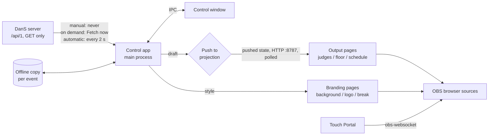

# Dance Projector – specification

Projection for dancesport competitions, built in OBS. Live competition data comes from DanS (dancesport.services) over the local network.

## Components

| Component | What it is | Details |
|---|---|---|
| DanS client | Read-only data layer over the DanS REST API | [Docs/dans-client](Docs/dans-client/SPEC.md) |
| Control app | Electron app for the operator | [Docs/control-app](Docs/control-app/SPEC.md) |
| Output pages | Web pages served by the app, used as OBS browser sources | [Docs/output-pages](Docs/output-pages/SPEC.md) |
| OBS show | Scenes, transitions, media handling, Touch Portal control | [Docs/obs-show](Docs/obs-show/SPEC.md) |
| Competitors | Photos and names of semifinal / final competitors on their own projection port; phone upload, webcam, ČSTS lookup | [Docs/competitors](Docs/competitors/SPEC.md) |
| Printout reading | Webcam / phone photo of a DanS round start list fills the judge panel and the competitor screen, offline | [Docs/printout](Docs/printout/SPEC.md) |

## Data flow

## Hard rules

1. Nothing may change DanS data or deliver anything to the federation. See D-01 in [DECISIONS.md](DECISIONS.md).
2. Judge PINs from the API are never stored or shown.
3. Output pages must keep working when DanS is briefly unreachable. They keep the last good data and show nothing alarming on screen.
4. Everything runs offline on the event LAN. No internet fonts or CDNs. Single exception: the ČSTS name lookup by IDT (C-33) uses csts.cz, only when the operator presses it; everything else works without it.

## Functional requirements

- Connect to a DanS server by address and choose an event.
- List all competitions of the event with number, title, state, check-in end, round and counts.
- Highlight running competitions (judging enabled). Several may run at once.
- The operator assigns competitions to display slot A and slot B.
- Each slot has a floor side name and a colour matching the floor lighting.
- Judges: add a photo and a display name per judge; stored per federation ID.
- Output pages: judges, floor overview, schedule, lower third, for 1920×1080, transparent background, updates without reload. (Heats exist but are not used for now, D-13.)
- Settings and judge data persist between app restarts.

## Revised requirements (2026-11-19, decisions D-13 to D-17)

- **Data modes.** Manual: no contact with DanS; the operator picks the panels from the event's judge list kept in the offline copy. On demand: DanS is read only when the operator presses **Fetch now** (3 GET requests once data exists). Automatic: polling every 2 s as before.
- **Offline copy.** Every successful read is saved per event, so data read during the rehearsal is available on the day without DanS.
- **Judge panels.** Per competition, from DanS or picked by hand; a hand-picked panel wins until the operator goes back to the DanS panel.
- **Push to projection.** OBS shows only the pushed state. The window shows a preview of the prepared state next to what is on screen, and lists what is not pushed yet. A switch sends every change automatically instead. The pushed state survives a restart.
- **Style per event.** Accent, second colour, background colour, panel colour and opacity; background as moving lights, a solid colour or an image (darkened by a set amount). Used by the output pages and by the OBS branding pages.
- **Reading the printed panel with a webcam** (D-17): planned after a sample printout is available.

## Competitors (2026-11-20, decisions D-22, C-31 to C-36)

- New **Competitors** tab: competitors per event by start number (DanS start list + typed + ČSTS lookup), several photos each.
- Own projection: port 8788, page `/out/competitors.html`, own **Push competitors**. Whole round or one competitor in spotlight.
- Photos: drag and drop, file picker, Ctrl+V (WhatsApp Desktop copy), webcam, phone upload page with QR code.
- Details: [Docs/competitors/SPEC.md](Docs/competitors/SPEC.md).
