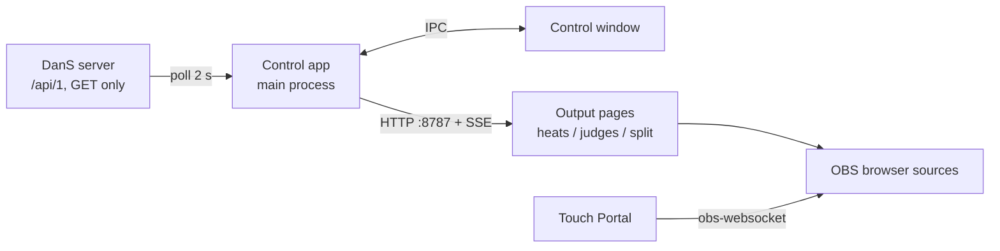

# Dance Projector – specification

Projection for dancesport competitions, built in OBS. Live competition data comes from DanS (dancesport.services) over the local network.

## Components

| Component | What it is | Details |
|---|---|---|
| DanS client | Read-only data layer over the DanS REST API | [Docs/dans-client](Docs/dans-client/SPEC.md) |
| Control app | Electron app for the operator | [Docs/control-app](Docs/control-app/SPEC.md) |
| Output pages | Web pages served by the app, used as OBS browser sources | [Docs/output-pages](Docs/output-pages/SPEC.md) |
| OBS show | Scenes, transitions, media handling, Touch Portal control | [Docs/obs-show](Docs/obs-show/SPEC.md) |

## Data flow

## Hard rules

1. Nothing may change DanS data or deliver anything to the federation. See D-01 in [DECISIONS.md](DECISIONS.md).
2. Judge PINs from the API are never stored or shown.
3. Output pages must keep working when DanS is briefly unreachable. They keep the last good data and show nothing alarming on screen.
4. Everything runs offline on the event LAN. No internet fonts or CDNs.

## Functional requirements

- Connect to a DanS server by address and choose an event.
- List all competitions of the event with number, title, state, check-in end, round and counts.
- Highlight running competitions (judging enabled). Several may run at once.
- The operator assigns competitions to display slot A and slot B.
- Each slot has a floor side name and a colour matching the floor lighting.
- Judges: add a photo and a display name per judge; stored per federation ID.
- Output pages: heats, judges and split screen, for 1920×1080, transparent background, live updates without reload.
- Settings and judge data persist between app restarts.
